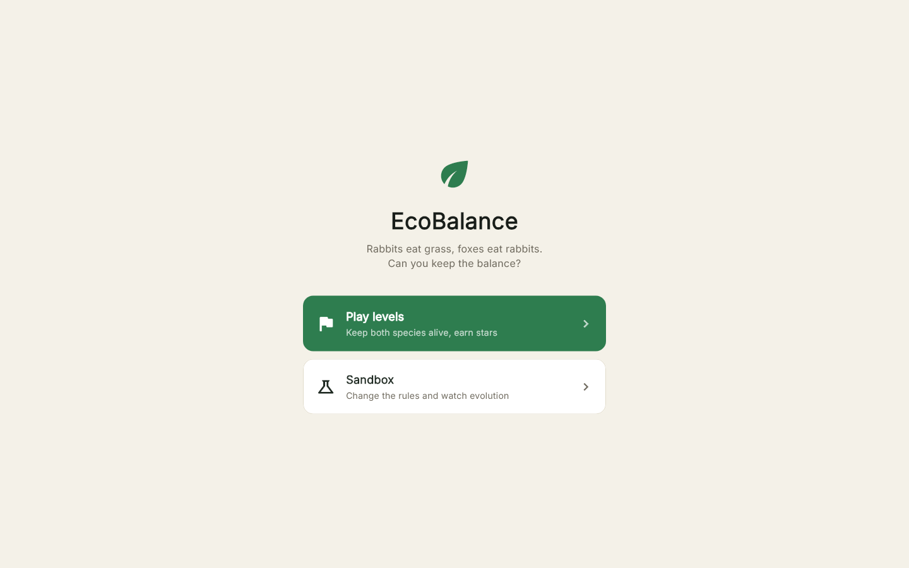
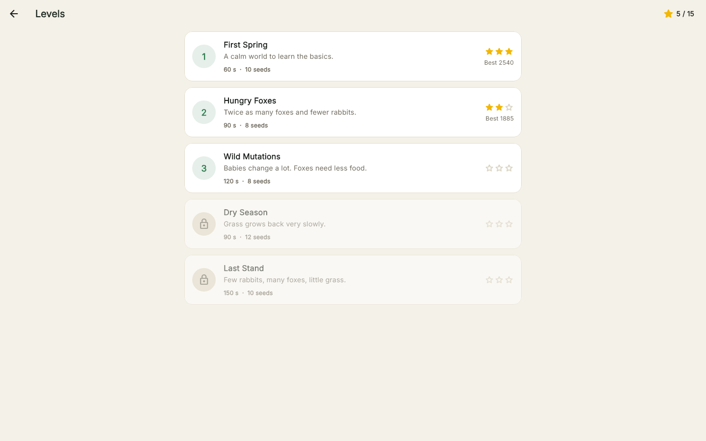
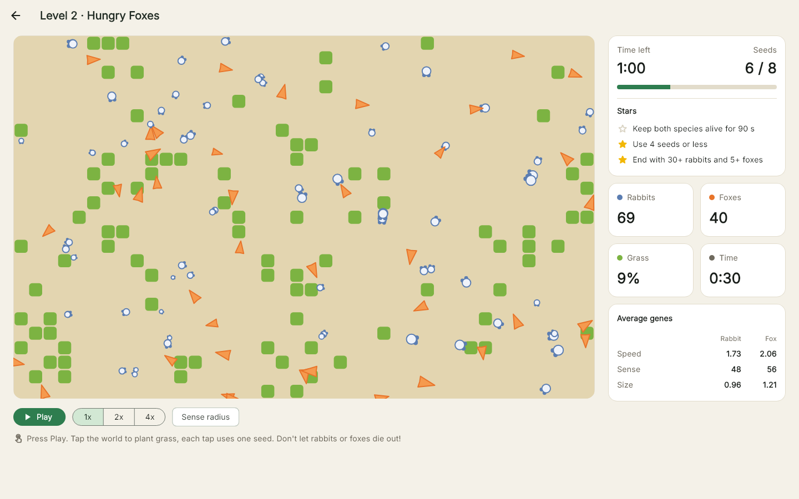
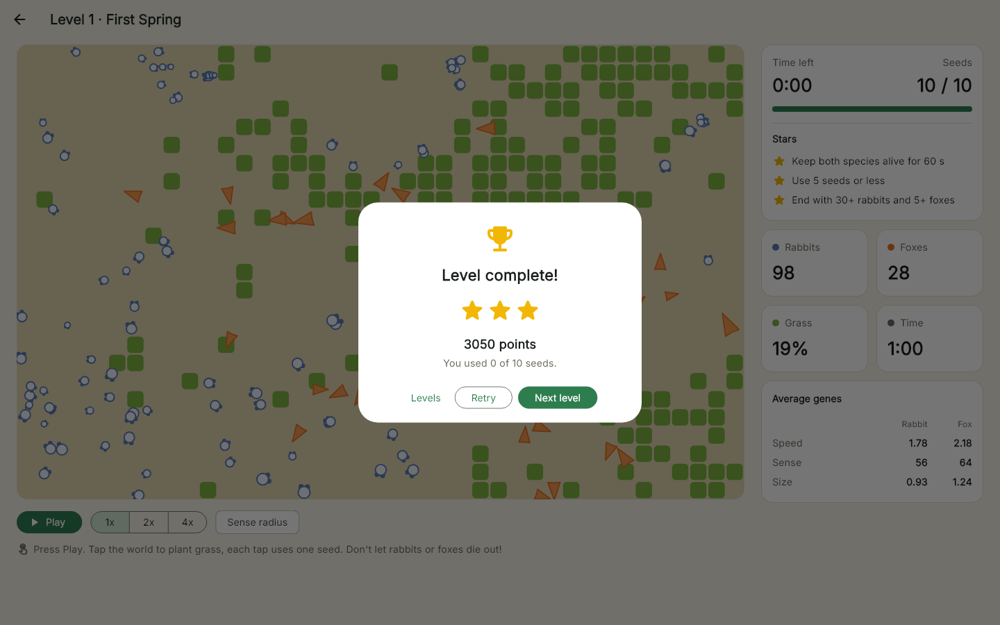
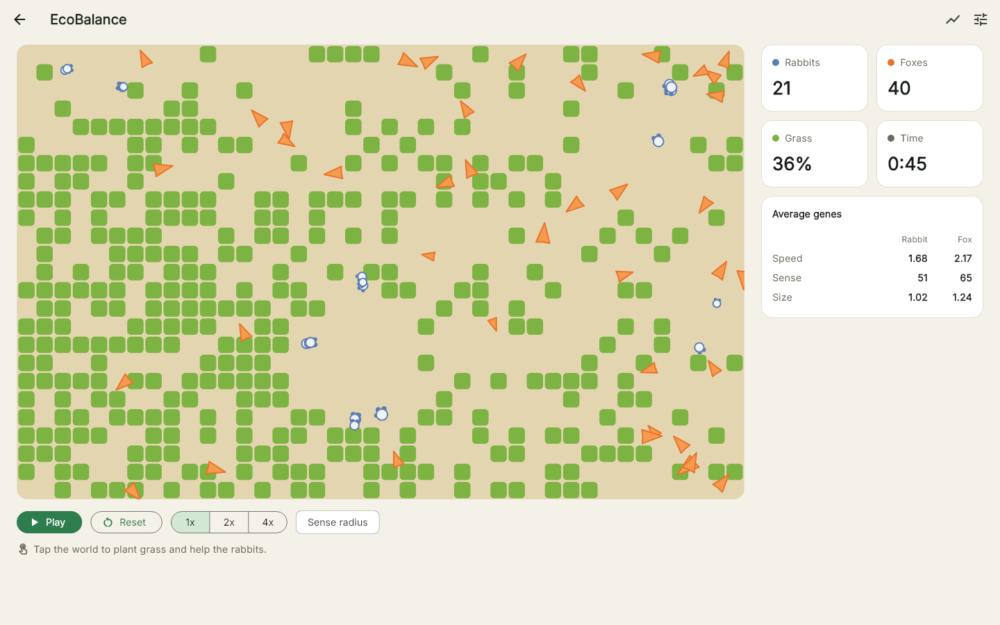
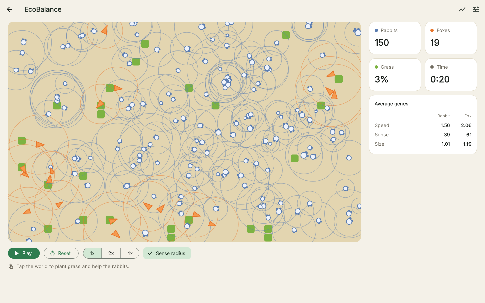
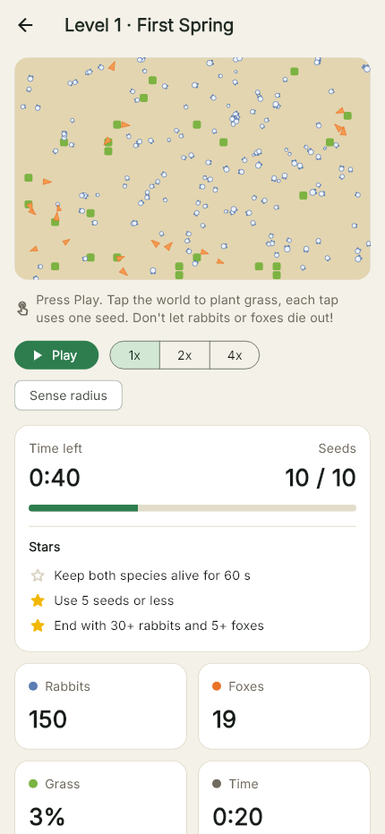

# EcoBalance

A small ecosystem game where rabbits and foxes evolve while you try to keep them both alive.

Grass grows on a grid, rabbits eat the grass and foxes eat the rabbits. Every animal has DNA (speed, sense radius and size), and babies get a slightly mutated copy of their parent's genes. Too many foxes and the rabbits disappear, too few rabbits and the foxes starve. Your job is to keep the balance.

Built with **Flutter** for **desktop and mobile**, using **BLoC** and **clean architecture**.

## Screenshots

| Home | Levels |
|:---:|:---:|
|  |  |
| **Playing a level** | **Level complete** |
|  |  |
| **Sandbox** | **Sense radius** |
|  |  |
| **Statistics** | **Settings** |
|  |  |

<p align="center">
  <br/>
  <b>Phone layout</b>
</p>

## How to play

1. Open **Play levels** and pick a level.
2. Press **Play**. The timer starts and the animals start moving.
3. **Keep both species alive until the timer ends.** If the rabbits or the foxes die out, you lose.
4. **Tap the world to plant grass.** Each tap plants a 3x3 patch and uses one seed, and every level gives you only a few seeds. Plant when the rabbits are hungry or the foxes are eating too many of them.
5. Use **2x / 4x** if you want to go faster.

Every level has 3 stars to earn:

- ★ Keep both species alive until the end.
- ★ Use half of your seeds or less.
- ★ End with a healthy world (30+ rabbits and 5+ foxes).

Clearing a level unlocks the next one, and your best stars and score are saved.

| # | Level | Time | Seeds | What makes it hard |
|---|---|---|---|---|
| 1 | First Spring | 60 s | 10 | Nothing, it's the tutorial |
| 2 | Hungry Foxes | 90 s | 8 | Twice as many foxes, fewer rabbits |
| 3 | Wild Mutations | 120 s | 8 | Big mutations, foxes need less food |
| 4 | Dry Season | 90 s | 12 | Grass grows back very slowly |
| 5 | Last Stand | 150 s | 10 | Few rabbits, many foxes, little grass |

I balanced the levels by running each one 20 times without a player, then with a simple bot that plants grass when the rabbits get low. The first levels are almost always won, while Last Stand is lost about half the time if you don't plant at the right moment.

The **Sandbox** is the free mode: unlimited grass, a settings screen to change the rules, and charts to watch evolution over a long time.

## Why I built it

I've always liked the evolution simulator videos where little creatures get faster or smarter over hundreds of generations. I wanted to build one myself, but with two species that push each other instead of one species against the food. It also turned out to be a good exercise in keeping the "game logic" in plain Dart, so it can be tested without any widgets.

The first version was only the simulation: fun to watch, but there was nothing to do. So I added a game mode with levels, a limited number of seeds and stars, which turns watching into playing.

## Features

- **Game mode** with 5 levels, a timer, limited seeds, 3 stars per level, a score and saved progress.
- **Live world** drawn with a `CustomPainter`: grass tiles, rabbits and foxes facing the way they walk.
- **Play / pause / reset** and **speed control** (1x, 2x, 4x).
- **Tap the world to plant grass**, handy when the rabbits are about to starve.
- **Sense radius** toggle to see how far every animal can see.
- **Live stats panel**: population of each species, grass coverage, time, and the average genes.
- **Statistics screen** with charts for rabbits, foxes, grass and average speed over time.
- **Export to CSV** to play with the numbers in Excel or Python.
- **Settings** for starting animals, grass growth, mutation rate and energy costs, saved between launches.
- Responsive layout: side panel on desktop, single column on phones.

## How the simulation works

The world is 800 x 500 units with a 40 x 25 grass grid. It runs at 30 ticks per second, and every tick each animal does this:

1. **Look around.** A rabbit looks for foxes first and runs away. If there's no danger, it walks to the closest grass it can see. A fox looks for the closest rabbit and chases it. If nothing is in sight, they wander.
2. **Move** at the speed in its DNA. Foxes sprint a little faster (x1.3) while they chase.
3. **Eat.** A rabbit standing on grass eats it (+20 energy). A fox touching a rabbit eats it (+55 x rabbit size), then rests for 3 seconds.
4. **Burn energy.** The cost per tick is `0.025 x speed² + 0.05 x size + 0.0015 x sense`. Being fast is expensive.
5. **Have a baby** when its energy is above 80% of its max (max = 100 x size). The parent gives half of its energy to the baby, and the baby's genes are the parent's genes plus a small random change (the mutation rate).
6. **Die** when its energy hits 0 or it gets too old (60 s for rabbits, 90 s for foxes).

Bare cells grow grass back with a small chance every tick.

### The predator-prey cycle

1. Lots of rabbits means foxes eat well and have many babies.
2. Too many foxes eat most of the rabbits.
3. With few rabbits left, foxes starve and their number drops.
4. With fewer foxes around, the rabbits come back, and the loop starts again.

You can see it in the statistics screen: the fox curve follows the rabbit curve with a delay.

### Evolution

No gene is "good" on its own, because everything has a cost. Fast rabbits escape more often but need more grass. A big sense radius finds food sooner but burns energy all the time. Over a few minutes, rabbits usually get faster to escape the foxes, and the foxes follow. You can watch it in the "Average speed" chart.

Some balancing rules keep the world from collapsing too quickly:

- Rabbits notice a fox only when it's close (60% of their sense radius).
- Rabbits can't go faster than 2.5, foxes can go up to 4.
- Foxes become adults later (10 s) than rabbits (2 s).
- There's a population cap (300 rabbits, 40 foxes) so the app stays smooth.

It can still collapse, and that's part of the fun. If the rabbits are dying out, plant some grass. If the foxes are gone, press Reset.

## Architecture

The app is split by feature, and every feature follows the same layers.

```
lib/
├── main.dart                     # loads settings, then runs the app
├── app.dart                      # MaterialApp + top level blocs
├── injection_container.dart      # get_it setup
├── core/
│   └── theme/                    # colors and app theme
└── features/
    ├── home/
    │   └── presentation/         # home page (game or sandbox)
    ├── game/
    │   ├── domain/               # Level, LevelProgress, levels list, GameRules, usecases
    │   ├── data/                 # progress saved with shared_preferences
    │   └── presentation/         # GameCubit, LevelsCubit, level select, game page, hud, result dialog
    ├── simulation/
    │   ├── domain/
    │   │   ├── entities/         # Animal, Dna, Grass, SimulationConfig, StatsPoint
    │   │   └── engine/           # SimulationEngine (pure Dart)
    │   └── presentation/         # SimulationBloc, page, canvas, painter, controls, stats panel
    ├── settings/
    │   ├── domain/               # SettingsRepository, GetConfig, SaveConfig
    │   ├── data/                 # json model + shared_preferences implementation
    │   └── presentation/         # SettingsCubit, settings page
    └── stats/
        ├── domain/               # StatsRepository, ExportStatsCsv
        ├── data/                 # csv builder + file implementation (path_provider)
        └── presentation/         # StatsCubit, stats page, line chart card
```

- **Domain** is plain Dart. The `SimulationEngine` has no Flutter imports and takes an optional `Random`, so tests can use a fixed seed and always get the same world.
- **Data** implements the repositories: settings are saved as JSON in `shared_preferences`, and stats are written as a CSV file in the documents folder.
- **Presentation** has the blocs and the widgets. Widgets only send events and draw the state.

The game mode reuses the simulation instead of copying it. The game page creates its own `SimulationBloc` with the level's config, reuses the same canvas and controls, and adds a `GameCubit` next to it. The cubit listens to every simulation update, counts down the timer, and uses the `GameRules` to decide when the level is won or lost. The rules (win, lose, stars, score) are plain static functions, so they're tested without any widget.

### How the BLoC flow works

```
Timer (every 33 ms) --SimulationTicked--> SimulationBloc --step() x speed--> SimulationEngine
                                                |
WorldCanvas / LiveStatsPanel  <--SimulationState(animals, grass, history, frame)
```

The animals are mutable objects (the engine moves them in place), so the state carries a `frame` counter. It changes on every update, which tells `BlocBuilder` and the painter that it's time to redraw.

When settings are saved, `SettingsCubit` emits the new config, and the simulation page forwards it to the bloc as `SimulationConfigChanged`, which starts a new world.

## Tech stack

| What | Package |
|---|---|
| State management | [flutter_bloc](https://pub.dev/packages/flutter_bloc), [equatable](https://pub.dev/packages/equatable) |
| Dependency injection | [get_it](https://pub.dev/packages/get_it) |
| Charts | [fl_chart](https://pub.dev/packages/fl_chart) |
| Storage | [shared_preferences](https://pub.dev/packages/shared_preferences) |
| CSV export | [path_provider](https://pub.dev/packages/path_provider) |
| Tests | [bloc_test](https://pub.dev/packages/bloc_test), [mocktail](https://pub.dev/packages/mocktail) |
| Font | Inter (bundled in `assets/fonts`) |

## Run it

You need Flutter 3.38 or newer.

```bash
git clone https://github.com/sirine2907/EcoBalance.git
cd EcoBalance
flutter pub get

flutter run -d windows     # or macos / linux
flutter run -d android     # phone or emulator
```

To build a release for Windows:

```bash
flutter build windows --release
```

## Tests

```bash
flutter test
```

- **Engine tests** with a fixed seed: eating grass, foxes catching rabbits, running away, babies, death by hunger and old age, planting grass, and that the same seed always gives the same world.
- **DNA tests**: mutation stays inside the gene ranges and respects the rabbit speed limit.
- **Game rules tests**: winning, losing (even on the last second), stars and score.
- **Bloc tests** (`bloc_test`) for `SimulationBloc`, `GameCubit`, `LevelsCubit`, `SettingsCubit` and `StatsCubit`.
- **Data tests** for the JSON model, the settings repository, saved level progress and the CSV export.

The screenshots above are golden tests. They run the world with a fixed seed and render each screen. To update them:

```bash
flutter test test/screenshots --update-goldens
```

## License

MIT, see [LICENSE](LICENSE).
